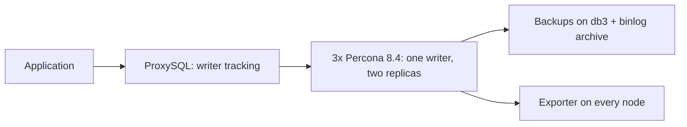

# Percona 8.4 Group Replication on Ubuntu

Ansible automation that deploys a production-style MySQL high-availability
stack: three Percona Server 8.4 nodes in single-primary Group Replication,
fronted by ProxySQL, with XtraBackup-based backups and Prometheus exporters
included. Ubuntu 24.04 amd64 throughout.

## The two topologies

| | One ProxySQL | Two ProxySQL |
|---|---|---|
| Inventory | `inventories/group-one-proxy.yml` | `inventories/group-two-proxies.yml` |
| Playbook | `playbooks/group-one-proxy.yml` | `playbooks/group-two-proxies.yml` |
| Servers | 3 database + 1 proxy | 3 database + 2 proxy |
| Client endpoint | Proxy IP, port 6033 | VIP or load balancer, port 6033 |
| Proxy redundancy | No | Yes, with keepalived VIP |

Both run the same deployment workflow; the inventory selects the topology.
Database failover is automatic in both: if the writer fails, the group elects
a new one and ProxySQL follows it.



## Deploy in four steps

The controller needs Ansible Core 2.16+. Target VMs need SSH, sudo and
package download access. Ansible installs services on your VMs; it does not
create them.

**1. Install dependencies** (once):

```bash
ansible-galaxy collection install -r requirements.yml
```

**2. Describe your servers.** Edit one inventory file and replace the example
IPs with your VM IPs. See [how inventories work](inventories/README.md).

**3. Set secrets and the group ID.** Edit `inventories/group_vars/all/main.yml`.
Create the encrypted vault file from the example key list, and generate one
UUID for the group:

```bash
ansible-vault create inventories/group_vars/all/vault.yml
python3 -c 'import uuid; print(uuid.uuid4())'   # put this in percona_group_name
```

**4. Check, deploy, verify** (same inventory every time):

```bash
ansible-playbook -i inventories/group-one-proxy.yml playbooks/operations/preflight.yml --ask-vault-pass
ansible-playbook -i inventories/group-one-proxy.yml playbooks/group-one-proxy.yml --ask-vault-pass
# take the first full backup on db3, then:
ansible-playbook -i inventories/group-one-proxy.yml playbooks/operations/verify.yml --ask-vault-pass
```

New to Ansible? Start with [the beginner guide](docs/beginner-guide.md).

## What you get

- **One writer, always.** Single-primary Group Replication with GTID and row
  binlogs. Writes go to the elected primary; replicas stay read-only.
- **Automatic failover.** The group detects a dead writer in about 10
  seconds, elects a new one, and ProxySQL moves traffic to it. Expect roughly
  15-30 seconds of write outage on a hard crash; in-flight writes fail fast
  and the application retries.
- **Safe reads after failover.** `group_replication_consistency =
  BEFORE_ON_PRIMARY_FAILOVER` prevents stale reads from a freshly elected
  writer.
- **Backups with point-in-time recovery.** Daily full XtraBackup on db3, a
  7-day retention policy that always keeps the newest chain, and binlog
  archiving every 5 minutes for replay to any point in time.
- **Monitoring ready.** `mysqld_exporter` on every database node with alert
  rules for group health; point your Prometheus at port 9104.
- **Guarded operations.** Preflight checks fail fast on wrong OS, duplicate
  server IDs, placeholder secrets and unreachable peers. Every destructive
  step (bootstrap, restore target selection) asserts before acting.

## Later: change settings, verify health

```bash
# Apply configuration changes, one node at a time:
ansible-playbook -i inventories/group-one-proxy.yml playbooks/operations/configure.yml --ask-vault-pass

# One-command health check, any time:
ansible-playbook -i inventories/group-one-proxy.yml playbooks/operations/verify.yml --ask-vault-pass
```

Configuration changes restart the affected MySQL node; unchanged nodes are
untouched. See the [configuration guide](docs/configuration-reference.md)
and the [operations runbook](docs/operations.md).

## What this is not

- Not cross-site disaster recovery. This is local high availability; the
  off-site copy is your backup plus archived binlogs.
- Not a managed database. You own the VMs, the OS patching and the
  Prometheus/Grafana side.
- Not validated until you validate it. Complete the [acceptance
  walkthrough](docs/production-checklist.md) (deployment, rerun, failover
  drill, restore test) before presenting it as production-ready.

## Documentation

[Deployment runbook](docs/deployment-runbook.md) ·
[Architecture](docs/architecture.md) ·
[Configuration](docs/configuration-reference.md) ·
[Backups and restore](docs/backup-and-restore.md) ·
[Monitoring](docs/monitoring.md) ·
[Operations](docs/operations.md) ·
[Troubleshooting](docs/troubleshooting.md) ·
[Beginner guide](docs/beginner-guide.md) ·
[4-server lab](LOCAL-RUN.md)

Six roles do the work: `percona_server`, `percona_group_replication`,
`proxysql`, `proxysql_ha`, `percona_backup`, `mysql_exporter`. Run the
playbooks, not the roles directly.

## Use as an Ansible Galaxy collection

Published as `opstree.percona` (Ansible Core 2.16+).

```bash
ansible-galaxy collection install opstree.percona
```

```yaml
# In your own playbook
- hosts: gr_members
  roles:
    - opstree.percona.percona_server
    - opstree.percona.percona_group_replication
```

Or run the shipped playbooks from the collection:

```bash
ansible-galaxy collection install opstree.percona
ansible-playbook -i inventories/group-two-proxies.yml opstree.percona.group-two-proxies --ask-vault-pass
```

The inventory groups (`gr_members`, `proxies`, `backup_sources`,
`monitoring_targets`, `restore_targets`) are the interface. Copy the
[example inventories](inventories) into your project, replace the IPs, and
create your own `vault.yml` from
[inventories/group_vars/all/vault.example.yml](inventories/group_vars/all/vault.example.yml).

### Maintainer release

```bash
ansible-galaxy collection build --output-path dist
ansible-galaxy collection install dist/opstree-percona-1.0.0.tar.gz   # test locally first
ansible-galaxy collection publish dist/opstree-percona-1.0.0.tar.gz --api-key "$GALAXY_API_KEY"
```

Publishing needs access to the `opstree` Galaxy namespace. Complete the
[acceptance walkthrough](docs/production-checklist.md) before publishing a
release you call production-ready.
