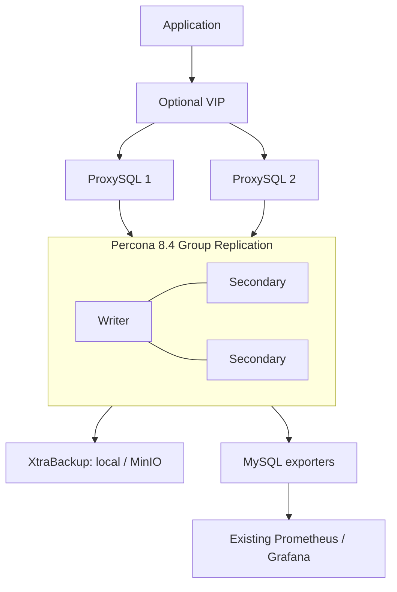

# Percona 8.4 LTS — standalone or Group Replication

Basic Ansible setup for **Ubuntu 24.04 amd64**. One server now, or three database nodes with a single writer and two ProxySQL endpoints.



## Start here

Run from the repository root. The controller needs Ansible Core 2.16+; target VMs need SSH, sudo and package download access.

```bash
ansible-galaxy collection install -r requirements.yml
```

1. Edit IPs in [standalone inventory](inventories/lab/hosts.yml) **or** [HA inventory](inventories/lab/ha.yml). Use only one inventory file per command.
2. Fill the keys in [vault.example.yml](inventories/lab/group_vars/all/vault.example.yml). Create `vault.yml` with `ansible-vault create inventories/lab/group_vars/all/vault.yml`; use `ansible-vault edit` if it already exists.
3. For HA, give this cluster its own UUID in [shared settings](inventories/lab/group_vars/all/main.yml): `python3 -c 'import uuid; print(uuid.uuid4())'`.
4. Choose a deployment:

```bash
# One server + scheduled backups + exporter
ansible-playbook playbooks/standalone.yml --ask-vault-pass

# Three database servers + two proxies + backups + exporters
ansible-playbook -i inventories/lab/ha.yml playbooks/ha.yml --ask-vault-pass
```

HA initially exposes each proxy on **6033**. To add one stable VIP, edit [proxy settings](inventories/lab/group_vars/proxies.yml): enable `proxysql_ha_enabled`, set the interface and an unused VIP, then rerun `playbooks/proxysql.yml` with the HA inventory. The network must support the VIP/VRRP arrangement.

## Six roles

| Role | Job |
|---|---|
| [percona_server](roles/percona_server/README.md) | Install 8.4, configure MySQL, create databases/users |
| [percona_group_replication](roles/percona_group_replication/README.md) | Bootstrap once, join fresh nodes, single-primary election |
| [proxysql](roles/proxysql/README.md) | Route application traffic to the current writer |
| [proxysql_ha](roles/proxysql_ha/README.md) | Optional Keepalived VIP for the two proxies |
| [percona_backup](roles/percona_backup/README.md) | Full/incremental backups and explicit isolated restore |
| [mysql_exporter](roles/mysql_exporter/README.md) | MySQL and Group Replication metrics |

## Change configuration

Edit `percona_max_connections`, buffer pool or other supported settings in inventory:

```bash
ansible-playbook -i inventories/lab/ha.yml playbooks/configure.yml --ask-vault-pass
```

This first version **restarts MySQL when its configuration changes**, one node at a time, waiting for an established group member to rejoin. Standalone restarts interrupt service; HA connections can also reconnect. Unchanged configuration does not restart MySQL.

## See it running

```sql
-- Run on any database VM: mysql -u root -p
SELECT MEMBER_HOST, MEMBER_STATE, MEMBER_ROLE
FROM performance_schema.replication_group_members;
```

Expected HA view: three `ONLINE` members, one `PRIMARY`, two `SECONDARY`.

```bash
mysql -h <proxy-ip-or-vip> -P 6033 -u appuser -p appdb
curl http://<database-ip>:9104/metrics
sudo /usr/local/bin/percona-backup backup full
```

## Scope of this first setup

Default datadir `/var/lib/mysql`; binlogs stay there. Fresh members join using retained binary logs; no automatic cloning or data replacement. Existing 8.0 servers are not upgraded by these playbooks.

Included: basic group setup, writer routing, optional proxy VIP, physical backups, exporters. Deferred: hardening, custom storage, live tuning without restarts, rolling upgrades, whole-cluster disaster recovery, binlog archiving/PITR, retention deletion and cross-site DR. Prometheus/Grafana are external; monitoring examples are supplied in the guide.

There are no separate preflight/validation roles or files. Essential setup checks remain around version replacement, bootstrap and restores. This branch has local checks; it is **not yet live-deployment or production validated**.

[Architecture](docs/architecture.md) · [Lab steps](docs/lab-tasks.md) · [Configuration](docs/configuration-reference.md) · [Backups](docs/backup-and-restore.md) · [Monitoring](docs/monitoring.md)
