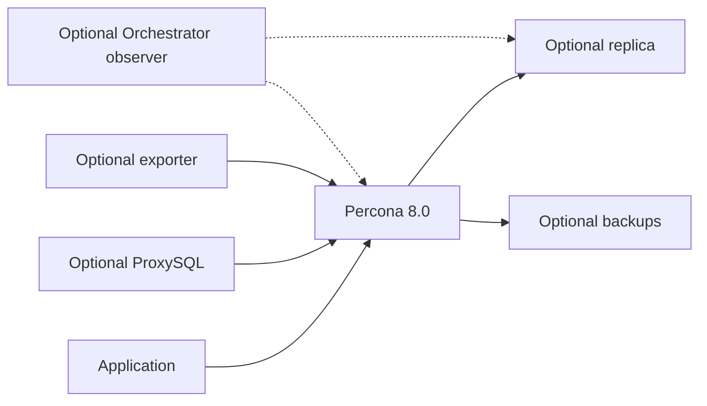

# Percona 8.0 — start small, add components



## Start with one database

Run the commands below from the repository root.

Controller: Ansible Core 2.16+ and the pinned collections below. Targets: Ubuntu 22.04/24.04 with systemd, SSH/sudo and access to an authorized **Percona 8.0** package repository. The candidate and running version are checked; **no 8.4 upgrade is performed**. Binary add-ons currently target amd64. Live OS/package acceptance remains required.

```bash
ansible-galaxy collection install -r requirements.yml
ansible-vault create inventories/lab/group_vars/all/vault.yml
```

In the Vault editor, copy the example keys and give `vault_percona_root_password` a unique password of at least 12 characters. Fill other keys only when adding that component. Edit `inventories/lab/hosts.yml` with your SSH address; edit `host_vars/db1.yml` if the database address differs. Permit database access only from intended private clients; this project does not manage firewalls.

```bash
ansible-playbook playbooks/standalone.yml --ask-vault-pass --syntax-check
ansible-playbook playbooks/standalone.yml --ask-vault-pass
```

On db1: `mysql -u root -p -e 'SELECT VERSION(), @@server_id, @@gtid_mode;'`.

**Fresh install:** tries the desired root credential, then supported local initial authentication. **Existing database:** stops unless you explicitly review and opt into [adoption](docs/migration.md). No grant bypass, datadir deletion or automatic major upgrade.

## Add only what you need

Use the **same inventory** as you grow. Optional groups start empty or name existing database nodes; standalone invokes only `percona_server`.

| Need | Playbook | Component guide |
|---|---|---|
| Standalone database | `playbooks/standalone.yml` | [Server](roles/percona_server/README.md) |
| Replica | prepare → seed → attach | [Replication](docs/standalone-to-replication.md) |
| Full/incremental backup | `playbooks/backup.yml` | [Backups](roles/percona_backup/README.md) |
| Database metrics | `playbooks/monitoring.yml` | [Exporter](roles/mysql_exporter/README.md) |
| Application proxy | `playbooks/proxysql.yml` | [ProxySQL](roles/proxysql/README.md) |
| Topology observation | `playbooks/orchestrator.yml` | [Orchestrator](roles/orchestrator/README.md) |
| Explicit recovery enablement | `playbooks/recovery_enable.yml` | [Recovery requirements](docs/orchestrator-and-failover.md) |
| Isolated restore | `playbooks/restore.yml` | [Restore](docs/backup-and-restore.md) |

Example: `ansible-playbook playbooks/monitoring.yml --ask-vault-pass`.

Each role has **`preflight.yml` → component tasks → `validation.yml`**. Exporter account creation is on the designated writer; the service runs on each selected database node. Add-ons preserve the server role's configuration; explicit restore adds a temporary isolation guard. No restore runs during normal backup configuration.

## Find your way

- [Run the lab one task at a time](docs/lab-tasks.md)
- [Verify a standalone installation: commands and expected results](docs/standalone-verification.md)
- [What each component means](docs/concepts.md)
- [Architecture and ownership](docs/architecture.md)
- [Configuration reference](docs/configuration-reference.md)
- [Old-to-new migration](docs/migration.md)
- [Validation and live acceptance](docs/validation.md)
- [EOD report: changes, fixes and limitations](docs/EOD_REPORT.md)
- [Liquibase boundary](docs/liquibase.md)
- [Historical snapshot](archive/README.md)

The old layout is archived for reference. PMM and the unsafe automatic rejoin script are not part of active playbooks. This implementation needs live deployment/restore/failover acceptance before being described as production-validated.

```text
playbooks/            # Choose the action: standalone, backup, replication, ...
inventories/lab/      # Hosts, component settings and your encrypted Vault file
roles/               # Six independent implementations, each with its own README
docs/                # Learning path, operations, migration and EOD report
tests/               # Local checks; no infrastructure changes
archive/legacy/      # Original implementation retained for reference
```
