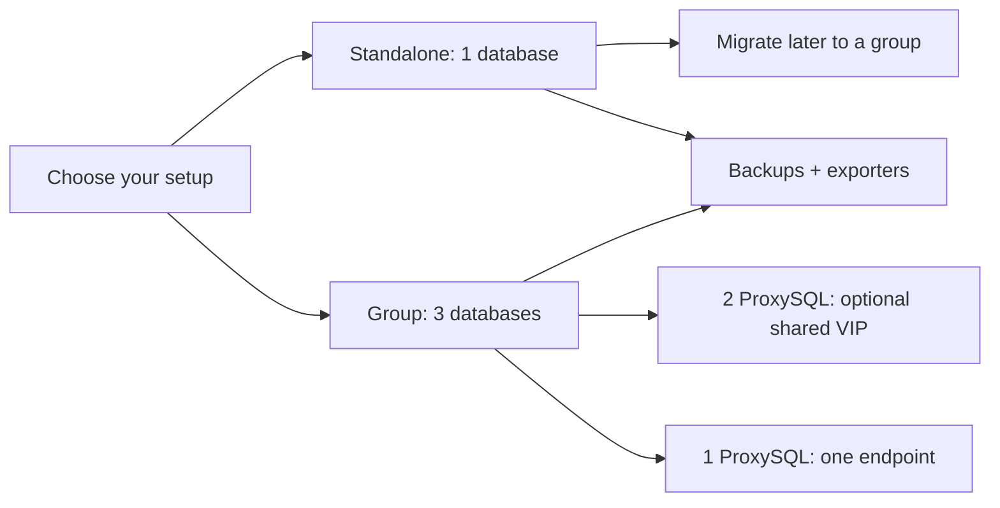

# Percona 8.4 LTS — choose one of four setups

Ansible setup for Ubuntu 24.04 amd64. Each deployment includes **backup setup and MySQL monitoring exporters**. Connect exporters to your existing Prometheus/Grafana.

| Choice | Inventory | Deployment playbook |
|---|---|---|
| **1. Standalone** — one database | `inventories/standalone.yml` | `playbooks/standalone.yml` |
| **2. Group + two ProxySQL** — three databases, two proxies | `inventories/group-two-proxies.yml` | `playbooks/group-two-proxies.yml` |
| **3. Migrate standalone → group** — reuse db1, add two databases and two proxies | `inventories/migrate.yml` | `playbooks/migrate.yml` |
| **4. Group + one ProxySQL** — three databases, one proxy | `inventories/group-one-proxy.yml` | `playbooks/group-one-proxy.yml` |

**Pick one row, not all four.** The inventory lists VMs; Ansible installs services on those VMs, it does not create them.



## Start in three steps

1. **Choose inventory:** replace the example IPs in your selected file. [Inventory explanation](inventories/README.md).
2. **Set values:** edit `inventories/group_vars/all/main.yml`; create or edit encrypted `inventories/group_vars/all/vault.yml` using the keys in `vault.example.yml`. For a new group, generate one UUID and set `percona_group_name`.
3. **Run your setup:** use the matching command in the [four-setup runbook](docs/deployment-runbook.md).

The controller needs Ansible Core 2.16+; VMs need SSH, sudo and package download access. Install dependencies once:

```bash
ansible-galaxy collection install -r requirements.yml
```

First time using Ansible? Read [the short beginner guide](docs/beginner-guide.md).

## Verify or change settings later

Keep using the **same inventory** you deployed. Example for standalone:

```bash
# After taking the first backup, check the setup:
ansible-playbook -i inventories/standalone.yml playbooks/operations/verify.yml --ask-vault-pass

# Edit settings in group_vars/all/main.yml, then apply them:
ansible-playbook -i inventories/standalone.yml playbooks/operations/configure.yml --ask-vault-pass
```

For a group, replace only the inventory with `inventories/group-two-proxies.yml` or `inventories/group-one-proxy.yml`.

Configuration changes currently restart affected MySQL nodes, one at a time. Unchanged configuration does not restart MySQL. [Configuration guide](docs/configuration-reference.md).

## What to expect

- Data and binlogs use `/var/lib/mysql`.
- Standalone has no database failover. Groups elect one writer automatically.
- One proxy has no proxy redundancy. For two proxies, configure the VIP or your existing load balancer to provide one stable endpoint.
- Monitoring servers are external. Backup schedules are installed, but take the first backup before verification.
- Migration is Percona **8.4 standalone to Group Replication**, not an 8.0 upgrade. Read [migration prerequisites](docs/migrate-standalone-to-gr.md) first.
- Run the [acceptance walkthrough](docs/production-checklist.md#acceptance-walkthrough-deployment--rerun--failover--restore) before claiming production validation.

## Reference

[Architecture](docs/architecture.md) · [Backups and restore](docs/backup-and-restore.md) · [Monitoring](docs/monitoring.md) · [Operations](docs/operations.md) · [Troubleshooting](docs/troubleshooting.md)

Six reusable roles power these four setups: `percona_server`, `percona_group_replication`, `proxysql`, `proxysql_ha`, `percona_backup`, `mysql_exporter`. You normally run the deployment playbooks, not individual roles.

## Use as an Ansible Galaxy collection

Collection: `opstree.percona`. Requires **Ansible Core 2.16+**. Collection dependencies install automatically.

```bash
# After publication to Galaxy
ansible-galaxy collection install opstree.percona
```

For a standalone server, create `inventory.ini` with your VM address:

```ini
[primary]
db1 ansible_host=192.0.2.11 ansible_user=ubuntu
```

Create `deploy.yml`:

```yaml
---
- name: Install standalone Percona 8.4
  hosts: primary
  become: true
  vars_prompt:
  - name: percona_root_password
    prompt: MySQL root password
    private: true
  vars:
    percona_server_id: 101
    percona_bind_address: '{{ ansible_host }}'
  roles:
  - opstree.percona.percona_server
```

```bash
ansible-playbook -i inventory.ini deploy.yml
```

Use the same root password on reruns. For unattended use, put it in encrypted inventory variables instead of using `vars_prompt`. This example installs the server only; the complete deployment includes backups and monitoring.

For the complete standalone or HA setup, copy the [example inventory directory](inventories) into your project, replace the IPs, and create your own `group_vars/all/vault.yml` using [vault.example.yml](inventories/group_vars/all/vault.example.yml). The real Vault file is never distributed in the collection.

```bash
ansible-playbook -i inventories/standalone.yml opstree.percona.standalone --ask-vault-pass
# Or three database nodes and two proxies:
ansible-playbook -i inventories/group-two-proxies.yml opstree.percona.group-two-proxies --ask-vault-pass
```

The group names `primary` (standalone) and `gr_members` (HA) are part of the inventory interface. Use `database`, `proxies`, `backup_sources` and `monitoring_targets` as shown in the examples.

### Maintainer release

```bash
ansible-galaxy collection build --output-path dist
# Test the built package locally before publishing:
ansible-galaxy collection install dist/opstree-percona-1.0.0.tar.gz
```

Publishing requires access to the `opstree` Galaxy namespace. After reviewing the archive contents and completing the VM acceptance run:

```bash
ansible-galaxy collection publish dist/opstree-percona-1.0.0.tar.gz --api-key "$GALAXY_API_KEY"
```

Local build, installation and syntax checks do not establish production readiness. Follow the [acceptance walkthrough: deployment, rerun, failover and restore](docs/production-checklist.md#acceptance-walkthrough-deployment--rerun--failover--restore), which includes commands, pass criteria and a results table. Complete it before presenting this version as production-validated. Nothing is published automatically.
