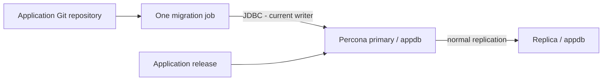

# Liquibase with this Percona role

**Yes—Liquibase fits here.** Use Ansible for database infrastructure and Liquibase for application schema history. Start with one changelog and one deployment job; no new always-running service is required.

This is an integration proposal with examples, reviewed on **15 October 2026**. Liquibase has not been installed, executed, or wired into the role. Return to the [technical walkthrough](../README_IN_DEPTH.md) for database prerequisites.

## 1. What it solves

Suppose development adds `customer.email`, staging gets a slightly different manual SQL edit, and production is left unchanged. Liquibase gives the team a shared ordered record of those changes and records what each database has applied.

| Responsibility | Owner |
|---|---|
| Install Percona, configure memory/ports, manage services | Ansible |
| Create the empty `appdb` database and access accounts | Ansible |
| Add/alter application tables, columns, indexes, controlled reference data | Liquibase |
| Replicate committed database changes | MySQL replication |
| Route app connections and manage failover | ProxySQL / orchestration |
| Restore lost data | Backup/recovery workflow |

Liquibase supports MySQL through JDBC. Percona's MySQL compatibility makes that the appropriate connection type, but test your exact Percona, Liquibase, Java and Connector/J combination. Do not interpret MySQL compatibility as a separately verified Percona matrix. [Liquibase MySQL integration](https://docs.liquibase.com/community/integration-guide-5-0/connect-liquibase-with-mysql-server), [Community database support](https://docs.liquibase.com/community/integration-guide-5-0/what-databases-are-supported-by-liquibase).

## 2. Where it runs and connects



Run Liquibase once from a CI runner or controlled operator machine. Connect directly to the **verified current writer** at first. A stable DNS name is useful only if your operational process actually keeps it pointed at that writer; this role provisions no such endpoint.

Do not run it separately on each replica: changes and tracking tables should flow through normal replication. Do not send it through the current general SELECT-to-reader rules. Its lock/history reads must observe the same authoritative database as its writes. A later ProxySQL migration account can be pinned to the writer with higher-priority username-specific routing, but direct writer access is simpler initially.

Before starting, verify `@@read_only=0`, `@@super_read_only=0`, the intended server identity, healthy replication, and that no failover/maintenance is underway. A precheck cannot prevent a later failover: serialize migrations with the team's failover/maintenance process and stop to reconcile if the writer changes mid-run.

## 3. The few concepts you need

**Changelog:** the ordered list of changes. **Changeset:** a uniquely identified change with an author and file identity. Keep normal applied changesets immutable; add another changeset to evolve the database.

Liquibase records history and checksums in `DATABASECHANGELOG`. A changed applied changeset can produce a checksum mismatch; investigate instead of clearing checksums just to make a build green. [History table](https://docs.liquibase.com/concepts/tracking-tables/databasechangelog-table.html).

`DATABASECHANGELOGLOCK` coordinates Liquibase runs against that database. It does not fence an old MySQL primary or coordinate arbitrary DDL from other tools. For a stale lock, prove no migration process remains before releasing it. [Lock table](https://docs.liquibase.com/concepts/tracking-tables/databasechangeloglock-table.html).

## 4. Minimal example

Prefer keeping migrations in the **application repository**, beside the release that depends on them. Create this small layout:

```text
application/
└── db/
    ├── changelog.sql
    └── README.md       # how this app runs migrations
```

Use a pinned Liquibase distribution, supported Java runtime and compatible MySQL Connector/J driver on the runner. Check whether the chosen distribution bundles the driver; if not, install it through that version's supported dependency mechanism. The example uses common CLI commands; verify them with the pinned version's `--help` rather than downloading `latest` in every job.

Create `db/changelog.sql`:

```sql
--liquibase formatted sql

--changeset app-team:001-create-customer
CREATE TABLE customer (
    id BIGINT NOT NULL AUTO_INCREMENT,
    name VARCHAR(200) NOT NULL,
    PRIMARY KEY (id)
) ENGINE=InnoDB;
--rollback DROP TABLE customer;

--changeset app-team:002-add-customer-email
ALTER TABLE customer ADD COLUMN email VARCHAR(255) NULL;
--rollback ALTER TABLE customer DROP COLUMN email;
```

One structural operation per changeset keeps failures easier to understand. SQL-format rollback needs explicit statements. The shown rollbacks are for a disposable exercise: dropping the table or column destroys data. They are not a production recovery policy. [Formatted SQL](https://www.liquibase.com/blog/liquibase-formatted-sql), [Defining rollback](https://support.liquibase.com/hc/en-us/articles/29383086010523-How-to-Define-Rollbacks).

### Dedicated account

Provision a `liquibase` account through Ansible with a source host restricted to the runner and privileges scoped to `appdb`. For the above example plus tracking-table maintenance, a starting grant is:

```yaml
percona_users:
  - name: liquibase
    host: "192.0.2.30"  # replace with actual runner source address
    password: "{{ vault_liquibase_password }}"
    priv: "appdb.*:SELECT,INSERT,UPDATE,DELETE,CREATE,ALTER,DROP,INDEX"
```

This list replaces any prior `percona_users` list; merge the required application/exporter entries deliberately in your deployment configuration. Fix the current user-task logging before provisioning real credentials. Add privileges only when reviewed migrations need them, such as views or routines. The normal application account should not receive this account's DDL rights.

Ensure `appdb` already exists and that source binlog filters do not exclude its schema changes or tracking tables. With this repository, supply the database list only to the database-creation task until its implicit binlog-filter coupling is removed.

### Connection configuration and commands

Have CI inject these variables from environment configuration and its secret store:

```text
LIQUIBASE_COMMAND_URL=jdbc:mysql://writer.example.internal:3306/appdb?sslMode=VERIFY_IDENTITY
LIQUIBASE_COMMAND_USERNAME=liquibase
LIQUIBASE_COMMAND_PASSWORD=<injected secret>
LIQUIBASE_COMMAND_CHANGELOG_FILE=db/changelog.sql
```

`writer.example.internal` is a placeholder, not an endpoint this role creates. Configure trusted CA material for Connector/J and a server certificate matching the actual hostname before using this URL. Do not commit the password or echo the environment in build logs. Environment-variable names and command placement should be confirmed against your pinned CLI's parameter documentation. [Liquibase parameters](https://docs.liquibase.com/community/reference-guide-5-0-2/parameters/working-with-command-parameters).

From the application repository:

```bash
liquibase validate
liquibase status --verbose
liquibase update-sql > planned-migration.sql
# Review the generated SQL and test against a disposable database first.
liquibase update
liquibase status --verbose
```

`validate` checks changelog structure and related consistency; it does **not** prove the SQL is valid for the target or safe under production load. It may create tracking tables, so do not assume every preflight command is strictly read-only. [Validate](https://docs.liquibase.com/commands/utility/validate.html).

`update-sql` produces the planned SQL for review without applying the application changesets. Review table locks, data movement and destructive operations. Retain the reviewed changelog revision and SQL with the deployment record. [Update SQL](https://docs.liquibase.com/commands/update/update-sql.html).

**Lab acceptance:** both changesets appear in `DATABASECHANGELOG`; `customer.email` exists; a second `update` has nothing new to apply; the same schema and history eventually appear on the replica. Test against the chosen versions—these commands were not executed as part of this documentation.

## 5. A small deployment workflow

1. Developer adds a changeset in an application pull request.
2. CI validates it and applies it to a disposable database with representative schema/data.
3. Review the SQL, expected runtime, compatibility with old/new app code, and recovery approach.
4. On release, verify writer identity, no competing migration, healthy replication and suitable backup coverage.
5. Run one Liquibase job. Stop the release if it fails; inspect actual schema and tracking history before retrying.
6. Verify schema and replica catch-up, then deploy application code that depends on the change.

A Semaphore installation can run this as a separate job if it is already your deployment runner. This repository has no ready-to-use Liquibase or Semaphore pipeline. Add one explicit job rather than invoking migrations on every Ansible host or every application instance startup.

### Existing database adoption

Do not run a create-from-empty changelog over an existing application schema. First capture and review an accurate baseline, compare it against the existing environment, and test rebuilding a disposable database from it. Only after confirming equivalence should you mark the verified baseline as already applied using the selected Liquibase version's baseline/synchronization workflow. Then introduce new changes normally. Blind synchronization can hide real schema drift.

### Failure, rollback and large tables

MySQL DDL commonly causes implicit commits, so a failed migration is not automatically an all-or-nothing transaction. Review actual schema and Liquibase history before a retry; prefer a forward corrective change where it preserves data. [MySQL implicit commits](https://dev.mysql.com/doc/refman/8.4/en/implicit-commit.html).

For disruptive schema evolution use **expand, migrate, contract**: add a compatible nullable column; deploy code that can use it; backfill in controlled batches; verify; only later remove the old column. Keep large backfills separate from a long blocking schema job. Rehearse on production-sized data and observe replication lag and metadata locks. Liquibase tracks a change; it does not make an `ALTER TABLE` automatically online or cheap.

Only evaluate an online-schema-change tool when measured locking/copy costs justify it. Such tools introduce their own foreign-key, trigger, disk, privilege and replication considerations. Likewise, PITR restores data to a past point; it is not a casual per-column rollback button.

## 6. Do we need a different tool?

If the application already has a reliable framework migration system, keep it as the single schema owner instead of adding Liquibase alongside it. If there is no migration history, the small Liquibase workflow above is a reasonable starting point. Evaluate alternatives only for a concrete missing capability; running two independent tools over the same schema adds coordination work without solving the underlying problem.

The first integration milestone is deliberately small: **one application database, one migration account, one SQL changelog, one CI job, and one successful rerun test**.
