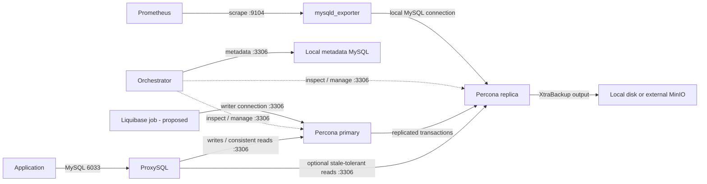

# Understand this Percona project

Start here, then follow [the technical walkthrough](../README_IN_DEPTH.md). The [improvement plan](IMPROVEMENTS.md) explains what to fix; the [Liquibase guide](LIQUIBASE.md) explains how to manage application schema changes.

This guide describes the files reviewed on **15 October 2026**. It distinguishes intended architecture from completed automation. No database deployment or recovery exercise was performed for this documentation.

## 1. What is Percona?

**Percona** is a company and a family of database products. **Percona Server for MySQL** is the database server used by this repository: a MySQL-compatible server with additional operational capabilities. Your application still connects with a MySQL driver and uses SQL. Percona Server is not a proxy, a backup store, or a failover manager. [Product documentation](https://docs.percona.com/percona-server/8.4/index.html).

Imagine an application that stores customer orders:

1. Percona Server stores the orders.
2. A second Percona Server can replicate those orders.
3. ProxySQL can choose which database connection receives a query.
4. Orchestrator can observe replication and coordinate promotion after a failure.
5. XtraBackup can copy the database into recoverable backup files.
6. MinIO can store those files away from the database host.
7. Monitoring tells you whether these services are healthy.
8. Liquibase can track changes such as adding an `orders.status` column.

You do not need all eight to start.

### Server, distribution, and cluster are different terms

| Term | Meaning for this project |
|---|---|
| MySQL | The database technology, SQL dialect, protocol, and ecosystem this project uses. |
| Percona Server for MySQL | The actual database service installed here. |
| Percona Distribution for MySQL | A collection of database software and supporting components. It is not another process through which queries pass. |
| Percona XtraDB Cluster / PXC | A different cluster architecture based on Galera. This repository does **not** configure PXC. |
| This repository's “HA cluster” | Intended to be a primary with asynchronous replicas, ProxySQL, and Orchestrator. |

Version matters: this code selects **8.0**, which reached end of life on **1 April 2026**; continued fixes require Percona's post-EOL offering. For new development, evaluate a tested 8.4 LTS baseline. This requires code and compatibility work, not merely changing a version string. [Percona lifecycle](https://www.percona.com/release-lifecycle-overview/).

## 2. What each component does

| Component | What it does | Why use it? | What exists in this repository? |
|---|---|---|---|
| Ansible | Connects to hosts and applies configuration tasks. | Repeatable installation and configuration. | One role containing optional task files. |
| Percona Server | Stores tables and executes queries. | The application's persistent database. | Package installation, configuration template, users, databases. |
| Replication | Copies source transactions to replicas. | Additional read capacity and possible promotion targets. | GTID or file/position setup; no automatic initial data clone. |
| ProxySQL | Accepts MySQL connections, pools backend connections, routes queries. | A stable application endpoint and controlled routing. | Installation, server/user tables, query rules, monitor credentials. |
| Orchestrator | Discovers replication topology and coordinates recovery. | Observe topology and eventually automate promotion. | Installation, local metadata database, discovery, recovery configuration and hook. |
| XtraBackup | Takes physical database backups. | Restore large databases without rebuilding them from SQL statements. | Full/incremental script templates with correctness gaps. |
| MinIO | Provides S3-compatible object storage. | Keep backup objects outside a database machine. | Only the `mc` client is wired into tasks; an unused server template is also present. |
| `mc` | MinIO's command-line client. | Upload, list, and retrieve objects. | Download, alias configuration, bucket setup. |
| `mysqld_exporter` | Exposes MySQL statistics over HTTP. | Let Prometheus collect database measurements. | Exporter binary, credentials file, systemd unit. |
| Prometheus | Scrapes and stores metrics over time. | Alerts and time-series monitoring. | An external dependency; no Prometheus server setup here. |
| Grafana | Displays metrics in dashboards. | See trends and investigate incidents. | No standalone Grafana provisioning here. |
| PMM | Percona Monitoring and Management: a monitoring platform. | Database dashboards and investigation workflows. | Optional client/registration tasks; external PMM server needed; integration needs correction. |
| Semaphore | A UI/job runner for Ansible automation. | Run approved playbooks consistently. | Referenced settings only; no functioning restore-job API integration. |
| Liquibase | Applies version-controlled schema changes. | Keep tables/indexes consistent across environments and releases. | Not implemented; a small integration is proposed separately. |

Orchestrator's configured upstream, `openark/orchestrator`, was archived on 18 February 2025. Evaluate maintenance and compatibility before adopting it for new automatic failover. [Upstream repository](https://github.com/openark/orchestrator).

## 3. How the connections fit together

The replication arrow represents data flow; the replica initiates the network connection to the primary. The monitoring branch shows one node for readability; normally you monitor every database node.

Normal application queries do not pass through Orchestrator, MinIO, PMM, or Liquibase. Ansible runs during provisioning or maintenance; it does not need to remain connected for the database to serve traffic.

### What happens to one order?

The application sends an `INSERT` to ProxySQL. ProxySQL routes it to the primary. The primary commits it and makes the transaction available in its binary log. A replica receives and applies the transaction later.

That delay matters: an immediate `SELECT` routed to a replica might not see the order yet. Start with reads and writes on the primary. Move only explicitly stale-tolerant reads to replicas after testing the application. The repository's broad `^SELECT` routing rule needs that review.

### What happens when a primary fails?

The intended sequence is: detect failure → prevent the old primary from accepting writes → choose a suitable replica → promote it → route traffic to it → reconnect the application → recover the old host separately.

The existing scripts do not demonstrate that entire sequence safely. In particular, the hook marks the failed host online in a reader group before validating it, and its rejoin functions are not called. Treat automatic failover as a later development milestone.

### What happens if someone deletes an important table?

Replication can copy the deletion too. A replica is therefore **not a backup**. Recovery needs an older usable backup, potentially followed by binary-log replay up to just before the mistake. This project does not implement continuous off-host binary-log archiving or a complete point-in-time restore workflow.

## 4. Vocabulary you will meet

### Database and replication

| Term | Plain-language meaning |
|---|---|
| Primary / source | The server accepting application writes. Existing variables call it `master`. |
| Replica | A server copying transactions from a source. Existing variables call it `slave`. Keep those variable names until code is migrated. |
| Asynchronous replication | The primary does not wait for each replica to apply a transaction before returning success. Recent acknowledged writes may be missing on a promotion candidate. |
| Replication lag | How far a replica is behind. A single lag number is not proof that replication is healthy. |
| Binary log / binlog | The server's change log used for replication and point-in-time recovery. |
| Relay log | The replica's locally received replication events awaiting application. |
| GTID | A global transaction identifier. Helps track which transactions each server has executed. Does not copy missing base data or prevent all data loss. |
| File/position replication | Tracks a location in a named binary-log file instead of a GTID set. |
| `server-id` / server UUID | Two distinct server identities. Replication nodes need unique identities; a physical clone needs deliberate UUID handling. |
| `ROW` binlog format | Records row changes for replication; it does not turn the cluster into synchronous replication. |
| `read_only` | Restricts ordinary client writes. Some privileged sessions can bypass it. |
| `super_read_only` | A stronger client-write restriction used for replicas; replication itself can still apply changes. |
| Promotion | Making a suitable replica the new writer. |
| Fencing | Preventing the old writer from taking writes, for example by isolating it from clients. |
| Split brain | Two nodes accept conflicting writes as if both were the primary. |
| Errant transaction | A transaction present on a node but absent from the intended authoritative history. It complicates safe rejoin. |
| HA | High availability: reducing interruption from failures. It is an end-to-end property, not a single installed package. |
| RPO / RTO | Maximum acceptable data loss measured in time / maximum acceptable recovery duration. Choose targets and measure them. |

### Storage, performance, and backups

| Term | Plain-language meaning |
|---|---|
| InnoDB | The storage engine used for transactional tables. |
| Buffer pool | RAM used to cache InnoDB data and indexes. Larger is useful only while enough memory remains for everything else. |
| Transaction / commit / rollback | A unit of work / making its changes durable / undoing uncommitted work where supported. |
| Redo log | Records needed for crash recovery. It is different from the binary log. |
| Slow query log | Records statements exceeding a configured duration, helping identify costly queries. |
| Connection pool | Reuses database connections instead of creating a new one for every operation. |
| Full backup | A base copy of the database needed to start a restore chain. |
| Incremental backup | Physical changes since a previous backup position. Requires its base and all intervening incrementals. |
| LSN | InnoDB log sequence number. Backup `from_lsn` and `to_lsn` describe continuity; it is not a GTID. |
| `xbstream` | The archive/stream format used to transport XtraBackup output. |
| `qpress`, gzip, ZSTD | Compression tools/formats. The required decompressor depends on the actual backup format and XtraBackup version. |
| Prepare | Apply recovery logs and incremental changes to make a physical backup ready to restore. |
| Retention | How long recoverable backup chains remain available. Keeping isolated files is insufficient. |
| PITR | Point-in-time recovery: restore a backup and replay retained binlogs to a chosen point. |
| Bucket / object / prefix | An object-storage container / stored item / beginning of an item's name. A prefix resembles a directory but is not a normal filesystem directory. |

### Automation and connections

| Term | Plain-language meaning |
|---|---|
| Role | A reusable Ansible package of tasks, variables, templates, and handlers. There is one here. |
| Inventory / group | The list of target hosts / a named collection of those hosts. |
| Playbook / play / task | An automation document / a set of operations for selected hosts / one operation. |
| Defaults / vars | Configurable role defaults / higher-precedence role variables. This repository still has old names in `vars/main.yml`. |
| Facts / `hostvars` | Collected host information / access to another host's variables. Several tasks require other hosts' IP facts. |
| Jinja2 / `.j2` | Template language/files that turn variables into configuration or scripts. |
| Handler / notify | An action, often a restart, scheduled when a task reports a change. |
| Toggle / tag | A boolean controlling inclusion / a label used to select tasks. Tags on dynamic includes do not automatically label child tasks. |
| Idempotence | Reapplying the same desired state should not make unnecessary changes. The current role does not fully achieve this. |
| Vault / `no_log` | Encryption for Ansible secrets at rest / suppression of sensitive task output. Both need correct use. |
| systemd / cron | Linux service management / scheduled jobs. Cron uses the target host's timezone. |
| Socket / TCP port | A local connection path / a network endpoint. MySQL accounts can behave differently for local and remote connections. |
| TLS | Encryption and identity verification for a connection. Skipping certificate checks removes verification. |
| Hostgroup | A ProxySQL set of backend servers, here conventionally writer `10` and reader `20`. |
| Runtime / disk config | ProxySQL's active settings / persisted settings used after restart. Both need updating. |
| DDL / DML | Schema changes such as `ALTER TABLE` / data changes such as `INSERT`. |
| Changeset / changelog | One tracked Liquibase change / an ordered collection of changes. |
| JDBC | The Java database connection interface used by Liquibase. |

## 5. A sensible learning order

1. **One database:** connect, create a database/user, run SQL, restart, check logs.
2. **Recovery:** take one full backup and restore it to a separate test host.
3. **Visibility:** collect basic health, disk, and connection metrics.
4. **One replica:** seed it correctly, follow a test write, inspect lag and errors.
5. **ProxySQL:** route everything to the writer, then test selected replica reads.
6. **Orchestrator:** observe topology first; automate failover only after fencing and recovery tests.
7. **Liquibase:** track application schema changes; this can start as early as the single-database stage.
8. **Additional components:** add incrementals, object storage, PMM, or more nodes only when a concrete need justifies them.

For a learning lab, start with one disposable database VM and add a second when learning replication. For the current HA layout, a third VM can host ProxySQL, Orchestrator, and its local metadata MySQL. That third host is a single point of failure; do not mistake this small teaching layout for a complete production HA design.
