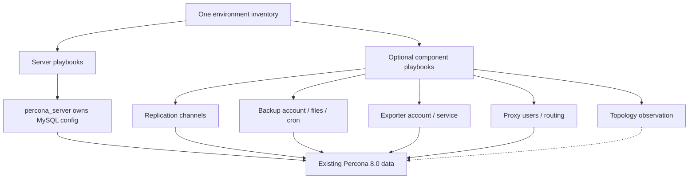

# Component map and ownership

| Boundary | Rule |
|---|---|
| MySQL configuration | percona_server owns the normal configuration. Explicit restore adds a temporary read-only/startup guard; healthy replica attachment removes that guard. No inventory-group-derived role changes. |
| Accounts | Add-ons create their own accounts through `percona_account_host`, normally the current writer. They replicate to replicas; read-only protection is not disabled to provision them. |
| Privileged login | `percona_root_password` is the local login. `percona_admin_password` is the writer's credential used by delegated account tasks; inventory maps both to Vault. |
| Addresses | `percona_address` is the database address; `ansible_host` is SSH. No dependency on another host's gathered network facts. |
| Restore | Explicit play, one target, preserved original datadir; prepare/checksums finish before stopping MySQL. |
| Promotion | Update inventory only after reconciling actual state. Server validation rejects unreviewed identity/topology changes. |
| Scheduling | Explicit desired cron state; disabling removes managed jobs. |
| Optional services | Skipping a play does not uninstall an existing service. |

Ports: MySQL 3306; ProxySQL frontend 6033/admin localhost 6032; exporter 9104; Orchestrator localhost 3000; MinIO uses your external HTTPS endpoint. Firewall and certificates are environment responsibilities. Deploy TLS material before setting server/replication TLS options.
