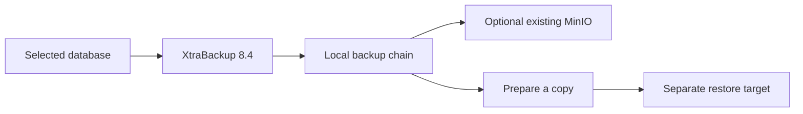

# Backups



The inventory schedules a full backup daily at 01:00 on the source VM's timezone, running on db3 (a replica, never the writer). Incrementals are optional. Backups retain local staging even with MinIO.

```bash
# Run on the selected backup VM
sudo /usr/local/bin/percona-backup backup full
sudo /usr/local/bin/percona-backup backup incremental
```

| Setting | Value |
|---|---|
| `backup_path` | `/var/backup/mysql` |
| `backup_schedule_enabled` | `true` in example inventory |
| `backup_incremental_enabled` | `false`; when true: Sunday full, Mon–Sat incremental |
| `backup_storage` | `local` or `minio` |
| `backup_hour` / `backup_minute` | `1` / `0` |
| `backup_retention_days` | `7`; prune runs daily at 02:30 and always keeps the newest chain |
| `backup_binlog_archive_enabled` | `true`; rotated binlogs are shipped every 5 minutes |

## Retention

`sudo /usr/local/bin/percona-backup prune --retention-days 7` deletes complete
backups older than the retention window. The newest complete backup and its
whole ancestor chain are always kept, so pruning can never remove the only
restorable chain. Archived binlogs older than the oldest kept backup are aged
out at the same time. A daily cron runs this automatically
(`backup_prune_enabled`).

```bash
# Inspect before you prune
sudo /usr/local/bin/percona-backup status
```

## Binlog archiving and point-in-time recovery

Every five minutes the backup source copies rotated (finished) binary logs to
`backup_binlog_path` (`/var/backup/binlog`); with MinIO storage they are also
mirrored to `<bucket>/<host>-binlog`. The active log is skipped because the
server is still writing to it. This gives point-in-time recovery: restore a
full backup to an isolated VM, then replay the archived binlogs up to the
target moment. The exact steps are in `docs/operations.md`.

## Optional MinIO

Supply an existing bucket and client download details:

```yaml
backup_storage: minio
backup_minio_endpoint: https://minio.example.internal
backup_minio_bucket: percona-backup
backup_minio_access_key: '{{ vault_minio_access_key }}'
backup_minio_secret_key: '{{ vault_minio_secret_key }}'
backup_mc_url: '<mc download URL>'
backup_mc_checksum: 'sha256:<checksum>'
```

Run `playbooks/operations/backup.yml` with your selected inventory. This does not install a MinIO server.

## Explicit restore

Prepare a separate standalone 8.4 VM and list it under `restore_targets`, outside `database`. Copy the complete backup chain into its `backup_path` first; MinIO download is manual in this version. Install Percona 8.4 on the target before restore.

```bash
ansible-playbook -i inventories/group-two-proxies.yml playbooks/operations/restore.yml --ask-vault-pass   --limit restore1 -e backup_restore_target=restore1   -e backup_restore_id=<backup-id> -e backup_restore_workdir=/var/tmp/restore-run1
```

Restore preserves the target's previous datadir, prepares a working copy and starts the restored database read-only. Use the **root password stored in the backup** when the restored server starts; keep source and target credentials identical for this simple workflow. It does not join the target to the group or promote it.

Retention pruning, binlog archiving and point-in-time replay are implemented (see above). Still not implemented: remote DR site, cross-region copies beyond MinIO mirroring. Monitor backup disk use; `status` shows the newest backup age at a glance.
