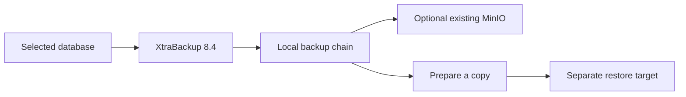

# Backups



The lab inventory schedules a full backup daily at 01:00 on the source VM's timezone. HA uses db3; standalone uses db1. Incrementals are optional. Backups retain local staging even with MinIO.

```bash
# Run on the selected backup VM
sudo /usr/local/bin/percona-backup backup full
sudo /usr/local/bin/percona-backup backup incremental
```

| Setting | Value |
|---|---|
| `backup_path` | `/var/backup/mysql` |
| `backup_schedule_enabled` | `true` in example inventory |
| `backup_incremental_enabled` | `false`; when true: Sunday full, Mon–Sat incremental |
| `backup_storage` | `local` or `minio` |
| `backup_hour` / `backup_minute` | `1` / `0` |

## Optional MinIO

Supply an existing bucket and client download details:

```yaml
backup_storage: minio
backup_minio_endpoint: https://minio.example.internal
backup_minio_bucket: percona-backup
backup_minio_access_key: '{{ vault_minio_access_key }}'
backup_minio_secret_key: '{{ vault_minio_secret_key }}'
backup_mc_url: '<mc download URL>'
backup_mc_checksum: 'sha256:<checksum>'
```

Run `playbooks/backup.yml` with your selected inventory. This does not install a MinIO server.

## Explicit restore

Prepare a separate standalone 8.4 VM and list it under `restore_targets`, outside `database`. Copy the complete backup chain into its `backup_path` first; MinIO download is manual in this version. Install Percona 8.4 on the target before restore.

```bash
ansible-playbook -i inventories/lab/ha.yml playbooks/restore.yml --ask-vault-pass   --limit restore1 -e backup_restore_target=restore1   -e backup_restore_id=<backup-id> -e backup_restore_workdir=/var/tmp/restore-run1
```

Restore preserves the target's previous datadir, prepares a working copy and starts the restored database read-only. Use the **root password stored in the backup** when the restored server starts; keep source and target credentials identical for this simple workflow. It does not join the target to the group or promote it.

No automatic retention deletion, remote DR, binlog archiving or point-in-time replay is implemented in this initial setup. Monitor backup disk use.
