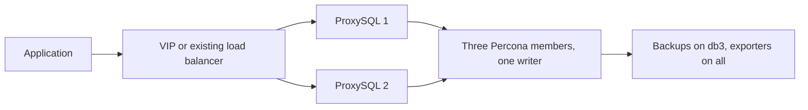

# Choose your deployment

Two topologies, one workflow. Pick the inventory that matches your proxy
count and run one command. Backup setup and database exporters are included
in both flows. Prometheus and Grafana remain external.

## Before you start

1. Install dependencies: `ansible-galaxy collection install -r requirements.yml`.
2. Replace the example VM addresses in your chosen inventory.
3. Fill credentials using `inventories/group_vars/all/vault.example.yml` as the key list; create your own encrypted `vault.yml` in the same directory.
4. For a new group, set a unique `percona_group_name` UUID in the shared variables. Keep the UUID unchanged on reruns.
5. Run the preflight check first. It fails fast on the mistakes that waste the most time.

```bash
ansible-playbook -i inventories/group-two-proxies.yml playbooks/operations/preflight.yml --ask-vault-pass
```

## 1. Group Replication with two ProxySQL nodes



Inventory: `inventories/group-two-proxies.yml`. Three database VMs and two
proxy VMs. For one stable client endpoint, configure the VIP and interface
and enable `proxysql_ha_enabled` in `group_vars/proxies.yml`, or point your
existing load balancer at both proxies. Two proxies alone do not create a
stable endpoint.

```bash
ansible-playbook -i inventories/group-two-proxies.yml playbooks/group-two-proxies.yml --ask-vault-pass
```

Connect through the VIP or load balancer on port 6033. ProxySQL always
follows the elected group writer. If the writer fails, the group elects a new
one automatically; ProxySQL moves the traffic within seconds. This is local
high availability; cross-site disaster recovery is not included.

## 2. Group Replication with one ProxySQL node


Inventory: `inventories/group-one-proxy.yml`. Three database VMs and one
proxy VM. The deployment runs the same workflow as the two-proxy setup; the
inventory is what differs.

```bash
ansible-playbook -i inventories/group-one-proxy.yml playbooks/group-one-proxy.yml --ask-vault-pass
```

Connect directly to the proxy IP on port 6033. Database failover still works
exactly as above, but the single proxy is a single point of failure: if the
proxy VM goes down, applications lose their endpoint even while the database
group stays healthy. Choose this for labs, cost-sensitive clients, or when a
load balancer already sits in front.

## After deployment

Take the first full backup on db3, then verify:

```bash
sudo /usr/local/bin/percona-backup backup full   # on db3
ansible-playbook -i inventories/group-two-proxies.yml playbooks/operations/verify.yml --ask-vault-pass
```

Use the same inventory for every later command. Day-to-day operations live
under `playbooks/operations/`: `configure` (apply setting changes),
`backup`, `monitoring`, `proxysql`, `preflight`, `verify` and `restore`.

Before calling any deployment production-ready, complete the [acceptance
walkthrough](production-checklist.md#acceptance-walkthrough-deployment--rerun--failover--restore):
deployment, rerun, failover drill and restore test.
