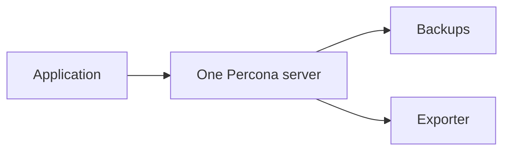
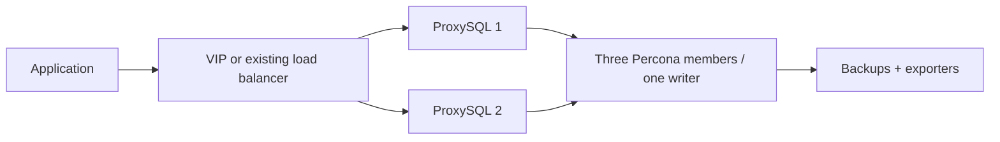

# Choose your deployment

Use one inventory and one deployment command. Backup setup and database exporters are included in the deployment flows. Prometheus/Grafana remain external.

## Before you start

1. Install dependencies: `ansible-galaxy collection install -r requirements.yml`.
2. Replace example VM addresses in your chosen inventory.
3. Fill credentials using `inventories/group_vars/all/vault.example.yml` as the key list; create or edit your own encrypted `vault.yml` in the same directory.
4. For a new group, set a unique `percona_group_name` UUID in shared variables. Keep the UUID unchanged on reruns.

## 1. Standalone, backups and monitoring



Inventory: `inventories/standalone.yml`. One database VM, no proxy.

```bash
ansible-playbook -i inventories/standalone.yml playbooks/standalone.yml --ask-vault-pass
```

Connect to the database IP on port 3306 using an application user configured in `percona_users`. The root account is for local administration. This profile has no database failover.

## 2. Full Group Replication setup



Inventory: `inventories/group-two-proxies.yml`. Three database VMs and two proxy VMs. Configure the VIP/interface and enable `proxysql_ha_enabled` in `group_vars/proxies.yml`, or provide an existing load balancer. Two proxies alone do not create a stable client endpoint.

```bash
ansible-playbook -i inventories/group-two-proxies.yml playbooks/group-two-proxies.yml --ask-vault-pass
```

Connect through the VIP/load-balancer endpoint on port 6033. ProxySQL follows the elected group writer. This is local HA; cross-site DR is not included.

## 3. Migrate an existing standalone server

Inventory: `inventories/migrate.yml`. One existing Percona 8.4 seed, two fresh database VMs, and the proxies configured in that inventory.

```bash
ansible-playbook -i inventories/migrate.yml playbooks/migrate.yml --ask-vault-pass
```

The existing migration flow checks the seed, takes a backup and runs the group setup. Plan a maintenance window. Read [migration prerequisites and recovery limits](migrate-standalone-to-gr.md) first; this is not an 8.0-to-8.4 upgrade or a merge of existing databases.

## 4. Group Replication with one proxy (four VMs)


Inventory: `inventories/group-one-proxy.yml`. Three database VMs and one **ProxySQL** VM, using the existing proxy role. No HAProxy installation or VIP is involved.

```bash
ansible-playbook -i inventories/group-one-proxy.yml playbooks/group-one-proxy.yml --ask-vault-pass
```

Connect directly to the proxy IP on port 6033. Database primary election still works, but the single proxy is a single point of failure. This entry point reuses the group setup. The VIP role automatically skips inventories with only one proxy.

## Operational commands

Deployment entry points stay at the top of `playbooks/`. Optional day-to-day commands live under `playbooks/operations/`: configure, backup, monitoring, proxy configuration, preflight, verify and isolated restore.

After initial deployment, take the first full backup on the selected backup host before running the verification command. Follow [the acceptance walkthrough](production-checklist.md#acceptance-walkthrough-deployment--rerun--failover--restore) for exact steps and expected results.
