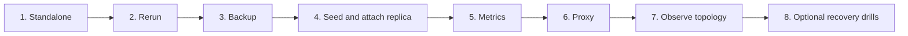

# Run the lab one task at a time

Use disposable Ubuntu VMs and the same `inventories/lab` throughout. Start with **db1 only**. Run controller commands from the repository root; replace example addresses and fill the required Vault credentials. Follow the [quickstart](../README.md) first.



This is a learning order. Backup, metrics and the proxy can also be added directly to a standalone server.

| Task | Run / change | Evidence before moving on |
|---|---|---|
| 1. Standalone | `ansible-playbook playbooks/standalone.yml --ask-vault-pass` | On db1: `mysql -u root -p -e 'SELECT VERSION(), @@server_id, @@gtid_mode;'`; version is 8.0, ID is 101, GTID is ON |
| 2. Rerun | Run the same command again without changing variables | No database restart or credential churn; previous data remains |
| 3. Backup | Fill backup password; run `ansible-playbook playbooks/backup.yml --ask-vault-pass`; on db1 run `sudo /usr/local/bin/percona-backup backup full` | Completed directory has manifest and success marker; scheduling stays off unless explicitly enabled |
| 4. Replica | Add db2 with ID 102; follow [prepare → seed → attach](standalone-to-replication.md) | Both replication threads run; a new row written on db1 appears on db2; db2 rejects application writes |
| 5. Metrics | Fill exporter password; select hosts in `monitoring_targets`; run `ansible-playbook playbooks/monitoring.yml --ask-vault-pass` | On each selected host: `curl -fsS http://127.0.0.1:9104/metrics`; find `mysql_up 1` |
| 6. Proxy | Add proxy host, verified package checksum and credentials; follow [proxy setup](proxysql.md) | Application account connects on port 6033; transactions reach the writer; configuration survives proxy restart |
| 7. Observer | Add Orchestrator host, verified checksum and credentials; follow [observer setup](orchestrator-and-failover.md) | Authenticated UI shows primary/replica topology; automatic recovery remains disabled |
| 8. Recovery drills | Only after tested fencing/routing hooks exist, use the separate recovery play | Partition/failure drills demonstrate one writer, correct routing and old-primary isolation |

For task 4, a small disposable probe makes replication visible. On db1, log in as root and run:

```sql
CREATE DATABASE IF NOT EXISTS lab_probe;
CREATE TABLE IF NOT EXISTS lab_probe.events (id INT PRIMARY KEY, message VARCHAR(80));
INSERT INTO lab_probe.events VALUES (1, 'standalone grew into replication');
```

On db2, `SELECT * FROM lab_probe.events;` should return the row after replication catches up. Keep this schema separate from application data. Never simulate failures against a real application to complete this checklist.

Before calling backup complete, test [an isolated restore](backup-and-restore.md), compare application rows/schema, and retain the source backup. Before enabling schedules, choose storage capacity and a chain-preserving retention procedure.

Record each task's play recap, database version and observed result. The [validation guide](validation.md) separates checks already run locally from these live exercises. Liquibase comes afterward as an [application migration job](liquibase.md), not another infrastructure dependency.
