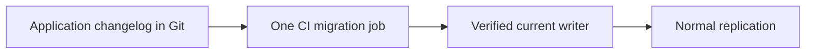

# Liquibase stays with the application

Ansible owns installation, configuration and access accounts. Liquibase owns application tables/indexes. Run one migration job against the verified writer; do not run on every replica or through unreviewed SELECT-to-reader routing.

Start with one schema, one migration account and one changelog. Validate, review generated SQL, apply on a disposable database, then release. Liquibase is not installed by these roles. The [earlier detailed learning guide](../archive/legacy/docs/LIQUIBASE.md) remains useful for concepts; its old role paths must be translated using the migration guide.
