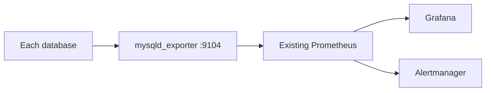

# Monitoring



The role installs exporters and enables Group Replication collectors. Prometheus, Grafana and Alertmanager remain outside this repository's deployment.

```bash
ansible-playbook -i inventories/group-two-proxies.yml playbooks/operations/monitoring.yml --ask-vault-pass
curl http://192.0.2.11:9104/metrics
```

Add to your existing Prometheus configuration:

```yaml
scrape_configs:
- job_name: percona
  static_configs:
  - targets: ['192.0.2.11:9104', '192.0.2.12:9104', '192.0.2.13:9104']
```

Start with the `mysql_up` metric and the `mysql_perf_schema_replication_group_*` series. This repository ships ready-made rules in `monitoring/mysql_alerts.yml`; copy its groups into an existing Prometheus rule file and keep the job name (`percona`) in sync with your scrape config.

Key metrics to watch:

| Metric | Meaning |
|---|---|
| `mysql_up` | Exporter can reach MySQL. |
| `mysql_perf_schema_replication_group_member_info` | One series per known member, with `member_state` and `member_role` labels. |
| `mysql_perf_schema_transactions_in_queue` | Transactions waiting in a member's applier queue; sustained growth means lag. |

Alert delivery and Grafana dashboards must be connected in your monitoring platform. No dashboard is automatically installed in this basic setup. Backup freshness is checked by `playbooks/operations/verify.yml` (a backup newer than 30 hours); wire its failure into your alerting if backups are part of your SLA.
