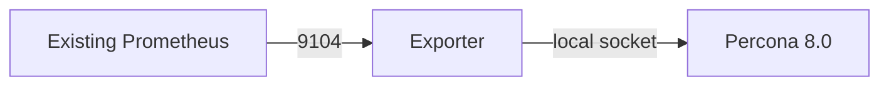

# Monitoring

Fill `vault_exporter_password`, select `monitoring_targets`, and run `playbooks/monitoring.yml`. Use `exporter_listen_address` for a private scraper-facing address. Validation requires `mysql_up 1` in `/metrics`; add these endpoints to your existing Prometheus configuration.

Watch database availability, replication failures/lag, backup age, disk capacity, connection pressure and query latency. PMM's old inconsistent registration code is archived; it is not silently enabled or presented as repaired.
