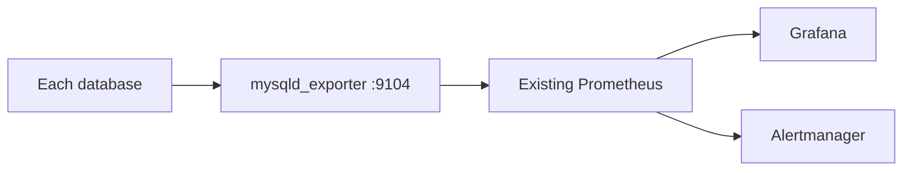

# Monitoring



The role installs exporters and enables Group Replication collectors. Prometheus, Grafana and Alertmanager remain outside this repository's deployment.

```bash
ansible-playbook -i inventories/lab/ha.yml playbooks/monitoring.yml --ask-vault-pass
curl http://192.0.2.11:9104/metrics
```

Add to your existing Prometheus configuration:

```yaml
scrape_configs:
- job_name: percona
  static_configs:
  - targets: ['192.0.2.11:9104', '192.0.2.12:9104', '192.0.2.13:9104']
```

Start with the `mysql_up` metric and the `mysql_perf_schema_replication_group_*` series. Add this rule to an existing Prometheus rule file:

```yaml
groups:
- name: percona
  rules:
  - alert: PerconaUnavailable
    expr: up{job="percona"} == 0 or mysql_up{job="percona"} == 0
    for: 1m
    labels:
      severity: critical
    annotations:
      summary: 'Percona or exporter unavailable: {{ $labels.instance }}'
```

Alert delivery and Grafana dashboards must be connected in your monitoring platform. No dashboard is automatically installed in this basic setup.
