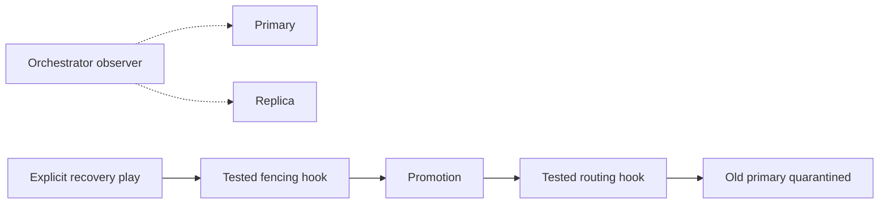

# Observe first; enable recovery separately

Add an `orchestrators` host; set the checksum and Vault topology/HTTP credentials; run `playbooks/orchestrator.yml`. Use an SSH tunnel to its authenticated localhost:3000 UI. SQLite metadata removes the old accidental local-MySQL dependency. Back up `/var/lib/orchestrator` if its history is important.

Default recovery filters are empty, hooks absent, and recovery disabled. The retained openark 3.2.6 upstream is archived; choosing a maintained build is a separate reviewed change, not an implicit upgrade here.

To use `playbooks/recovery_enable.yml`, supply **all** of:

- `orchestrator_recovery_tested: true`
- `orchestrator_recovery_filters`: explicit cluster filters
- `orchestrator_fencing_hook`: existing executable receiving failed host
- `orchestrator_routing_hook`: existing executable receiving failed and successor hosts

These hooks must run synchronously as the unprivileged orchestrator service account. Fencing must block unsafe promotion on failure and isolate the old writer; routing must verify the successor and quarantine the old host. Executable-file checks are not proof of these properties. Verify the pinned build's hook failure behavior and run partition/failover drills before enabling.

No generic fencing implementation, automatic old-primary rejoin, Semaphore restore API integration, control-plane redundancy, or measured RTO is claimed. The old hook that put a failed server online is retired. Rebuild/rejoin returned nodes through an explicit operator procedure, then reconcile inventory before any configuration rerun.

[Upstream synchronous recovery hook semantics](https://github.com/openark/orchestrator/blob/master/docs/configuration-recovery.md). Hook executability is checked as the service user, before recovery privileges are granted.
