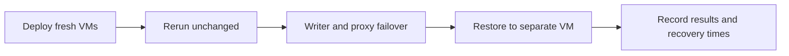

# Production checklist

Decisions to make with the client before the first production deploy. Each item
has a default in this repository; change the ones the client cares about and
record the answers next to the inventory.

## Topology and endpoint

| Decision | Default | Notes |
|---|---|---|
| Database nodes | 3, single-primary Group Replication | Minimum for quorum. Survives one node failure. |
| Proxy nodes | 2 | 1 is fine for labs only. |
| Stable endpoint | Keepalived VIP (`proxysql_ha_enabled`) or the client's existing load balancer | Keepalived needs VRRP (IP protocol 112) between the proxies. On cloud, prefer the cloud load balancer. |
| Read/write split | All traffic starts on the writer; read rules are opt-in (`proxysql_query_rules`) | Do not send every SELECT to secondaries unless the app tolerates slightly stale reads. |

## Data safety

| Decision | Default | Notes |
|---|---|---|
| Backup source | db3 (a secondary) | Never the writer. |
| Full backup cadence | Daily 01:00 | `backup_hour`, `backup_minute`. |
| Incrementals | Off | Turn on with `backup_incremental_enabled` for large data sets. |
| Retention | 7 days (`backup_retention_days`) | Prune keeps the newest chain no matter what. Size disk for retention plus one extra full. |
| Binlog archiving | On, shipped every 5 minutes (`backup_binlog_archive_enabled`) | Gives point-in-time recovery. Without it, RPO is the last full/incremental. |
| Off-site copies | `backup_storage: local` | Set `minio` with the client's bucket for off-host copies. This repo never installs MinIO itself. |
| RPO / RTO statement | Write it down | Example: RPO 5 minutes (binlog shipping), RTO 1 hour (restore drill proves it). |

## Security

| Decision | Default | Notes |
|---|---|---|
| Secrets | ansible-vault `vault.yml` | Never commit plaintext. Rotate before handover. |
| MySQL TLS | Off (`percona_require_secure_transport: false`) | Turn on when the client's apps support it. |
| Group Replication TLS | Off (`percona_gr_ssl: false`) | Turn on before the first bootstrap if required; changing it later needs a rolling group restart. Must be identical on all members. |
| ProxySQL admin | Localhost only, vault password | Never expose 6032. |
| OS access | `ubuntu` + SSH keys + sudo | Decide who holds the keys. |

## Sizing

| Item | Rule |
|---|---|
| RAM | 8 GB minimum per database node. The buffer pool auto-sizes to 50% of RAM. |
| Disk | datadir + 7 days of binlogs + (retention + 1) full backups + 20% headroom. Binlogs alone can surprise you on write-heavy workloads. |
| CPU | 2 vCPU is a lab floor, not a production recommendation. Size from the client's workload. |

## Monitoring

- Point Prometheus at `:9104` on every database node (scrape example in `docs/monitoring.md`).
- Install `monitoring/mysql_alerts.yml` into the existing Prometheus rule files.
- Decide who receives the alerts and test one alert end to end before handover.

## Acceptance walkthrough: deployment → rerun → failover → restore

Run this on dedicated staging VMs before the client production rollout. The failover steps deliberately stop services. Use your own inventory and addresses below; commands assume a repository checkout. Galaxy users can replace `playbooks/group-two-proxies.yml` with `opstree.percona.group-two-proxies` ; for operations, use names such as `opstree.percona.operations.verify`.



### 1. Deploy and establish a baseline

Fill the inventory and Vault credentials first. Use three database VMs, two proxies, and a separate restore VM for the later restore drill.

```bash
# Controller
ansible-playbook -i inventories/group-two-proxies.yml playbooks/operations/preflight.yml --ask-vault-pass
ansible-playbook -i inventories/group-two-proxies.yml playbooks/group-two-proxies.yml --ask-vault-pass
```

On any database VM, open `mysql -u root -p`:

```sql
SELECT VERSION(), @@server_uuid;
SELECT MEMBER_HOST, MEMBER_STATE, MEMBER_ROLE
FROM performance_schema.replication_group_members;
```

**Pass:** Percona 8.4, three ONLINE members and exactly one PRIMARY. Record which host is the current writer; do not assume db1.

On the current writer, create a small test table using the root SQL session:

```sql
CREATE TABLE appdb.acceptance_probe (id INT PRIMARY KEY, note VARCHAR(100));
```

From the application/client machine, connect through the actual client endpoint:

```bash
mysql -h <proxy-ip-or-vip> -P 6033 -u appuser -p appdb
```

```sql
INSERT INTO acceptance_probe VALUES (1, 'before backup');
SELECT * FROM acceptance_probe;
```

Wait until row 1 is visible on the selected backup source (db3 in the example). On that backup VM:

```bash
sudo /usr/local/bin/percona-backup backup full
sudo /usr/local/bin/percona-backup status
sudo /usr/local/bin/percona-binlog-ship /var/backup/binlog /etc/percona-backup/client.cnf
```

Record the returned backup ID. A fresh backup is needed before the verification play can pass:

```bash
# Controller
ansible-playbook -i inventories/group-two-proxies.yml playbooks/operations/verify.yml --ask-vault-pass
```

**Pass:** verification succeeds, the proxy accepts application queries, and the backup is complete. Also confirm the nodes appear in the client's monitoring platform and an alert reaches its intended recipient.

### 2. Rerun without changing inventory

On each database VM, record the service start time:

```bash
systemctl show mysql -p ActiveEnterTimestamp
```

Rerun the same deployment from the controller:

```bash
ansible-playbook -i inventories/group-two-proxies.yml playbooks/group-two-proxies.yml --ask-vault-pass
ansible-playbook -i inventories/group-two-proxies.yml playbooks/operations/verify.yml --ask-vault-pass
```

**Pass:** all members remain healthy, server UUIDs and row 1 remain unchanged, and MySQL service start times have not changed. Package/cache or scheduling tasks may report changes; inspect the reasons rather than requiring the entire recap to say `changed=0`.

### 3. Test writer failover

Keep two healthy database members running throughout this drill. Record the time, then run **only on the current writer**:

```bash
sudo systemctl stop mysql
```

On a surviving database VM:

```bash
mysql -u root -p -e "SELECT MEMBER_HOST, MEMBER_STATE, MEMBER_ROLE FROM performance_schema.replication_group_members;"
```

On either proxy, inspect routing:

```bash
mysql -h 127.0.0.1 -P 6032 -u admin -p -e "SELECT hostgroup_id, hostname, status FROM runtime_mysql_servers;"
```

Reconnect through the **same application endpoint**, then run:

```sql
INSERT INTO appdb.acceptance_probe VALUES (2, 'after writer failover');
SELECT * FROM appdb.acceptance_probe ORDER BY id;
```

**Pass:** a surviving node becomes PRIMARY, hostgroup 10 has one ONLINE writer matching it, row 1 remains and row 2 can be committed. Record time from service stop to the first successful application write. Existing connections may need reconnecting; verify the real application's retry behavior too.

On the stopped VM:

```bash
sudo systemctl start mysql
```

Wait for all three members to be ONLINE, then run `playbooks/operations/verify.yml` again. Do not run the full verification play while its first database host is stopped. A service-stop drill does not prove network-partition or sudden-power-loss behavior; record those as separate untested scenarios unless exercised.

### 4. Test the proxy endpoint

If a VIP is enabled, locate its owner with `ip -br address` on both proxies. Stop ProxySQL **only on the VIP owner**:

```bash
sudo systemctl stop proxysql
```

Reconnect through the same VIP and read/write the test table. Confirm the other proxy owns the VIP, record recovery time, then restore the stopped service:

```bash
sudo systemctl start proxysql
```

**Pass:** the unchanged client endpoint works through the surviving proxy. If using an external load balancer, test its endpoint instead. With a single proxy or two bare IPs and no client failover, mark endpoint HA as **not provided**.

### 5. Restore the recorded backup

Use a **separate, disposable Percona 8.4 VM**, with default `/var/lib/mysql`, no application traffic and the same root credential as the backup. Install Percona 8.4 on it first (a minimal playbook with the `percona_server` role is enough). Then add it under `restore_targets` in the inventory; it must not also be under `database`.

```yaml
restore_targets:
  hosts:
    restore1:
      ansible_host: 192.0.2.31
```

Copy the recorded backup directory, including `data/`, `manifest.json` and `_SUCCESS.json`, into `/var/backup/mysql` on restore1. For an incremental restore, copy every ancestor backup too. A MinIO restore requires downloading the chain first.

```bash
# Controller: substitute the real backup ID; use a new workspace each attempt.
ansible-playbook -i inventories/group-two-proxies.yml playbooks/operations/restore.yml --ask-vault-pass \
  --limit restore1 -e backup_restore_target=restore1 \
  -e backup_restore_id=YOUR_BACKUP_ID \
  -e backup_restore_workdir=/var/tmp/acceptance-restore-1
```

Connect directly to restore1 with `mysql -u root -p`:

```sql
SELECT @@server_uuid, @@read_only, @@super_read_only;
SELECT * FROM appdb.acceptance_probe ORDER BY id;
```

**Pass:** restored MySQL starts read-only with a different UUID; row 1 is present and row 2 is absent because it was committed after this backup. The live cluster remains unchanged. Record restore duration and the backup time recovered. This proves snapshot restore, not point-in-time replay or whole-site DR.

### Record the result

| Test | Result: PASS / FAIL / NOT RUN | Evidence |
|---|---|---|
| Fresh deployment | | Version, member list, application query |
| Unchanged rerun | | Recap, UUIDs, service start times |
| Writer failover and rejoin | | Old/new primary, first successful write, duration |
| Proxy endpoint failover | | Endpoint, new proxy, duration |
| Backup restore | | Backup ID, restored rows, UUID, duration |
| Monitoring notification | | Dashboard and received alert |

Save results with the inventory revision, collection version and date. Agree acceptable outage and data-loss limits with the client and compare the measured results. A skipped or failed test is not a pass. Remove the test table from the live writer after completing the drill.
