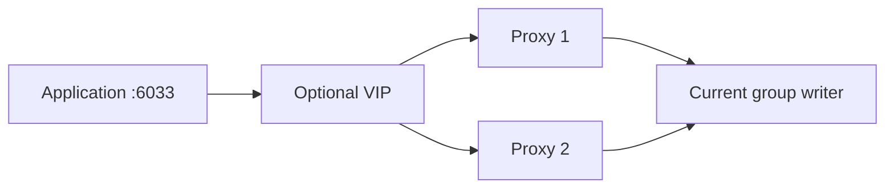

# Application endpoint



ProxySQL 3.0.1 uses its native Group Replication monitor. No legacy sys view is required. Ansible applies the same settings independently to both proxies; there is no extra ProxySQL configuration cluster.

| Hostgroup | Purpose |
|---|---|
| 10 | Active writer |
| 20 | Readers |
| 30 | Backup writers |
| 40 | Offline members |

All application traffic starts on hostgroup 10. Read routing is opt-in using `proxysql_query_rules`; this setup does not send every SELECT to a secondary.

```bash
ansible-playbook -i inventories/group-two-proxies.yml playbooks/operations/proxysql.yml --ask-vault-pass
mysql -h <proxy-ip-or-vip> -P 6033 -u appuser -p appdb
```

VIP configuration lives in [proxy variables](../inventories/group_vars/proxies.yml). Use two proxies, an unused VIP, the actual NIC name, and a network that permits VRRP and VIP movement. With no VIP, both proxy addresses work independently; clients need their own endpoint failover.

Local admin inspection:

```bash
mysql -h 127.0.0.1 -P 6032 -u admin -p
```

```sql
SELECT hostgroup_id, hostname, status FROM runtime_mysql_servers;
SELECT * FROM monitor.mysql_server_group_replication_log ORDER BY time_start_us DESC LIMIT 5;
```

Keepalived checks the local proxy service and TCP listener. It does not detect every backend or network failure; those scenarios need later acceptance testing. Changing a listener requires a proxy restart.
