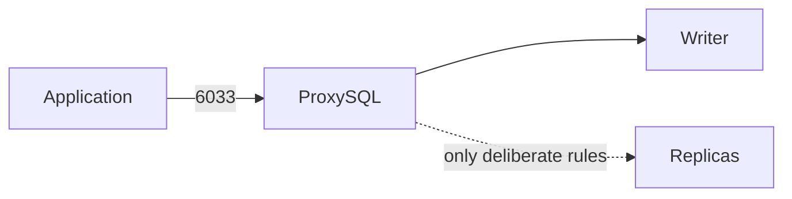

# Add ProxySQL

Add a `proxies` host, set a verified package checksum and Vault admin/monitor/app credentials. Create `appdb` on the writer first (server role's `percona_databases`, or a dedicated application provisioning play). Review backend/user examples in `group_vars/proxies.yml`; add each replica explicitly.

Run `playbooks/proxysql.yml`. It configures a dedicated monitor and matching schema-scoped app accounts, persists configuration, and verifies runtime writer/app access. The database hosts and application settings are not automatically reconfigured.

Test with `mysql -h <proxy-private-address> -P 6033 -u appuser -p appdb`. Switch the application endpoint only after testing transactions and reconnects. Default query rules are empty, so traffic uses writer hostgroup 10. Test stale-read tolerance before adding reader rules. Omitted rules/backends are preserved; use `state: absent` to remove an owned entry.

Admin stays at localhost:6032. Provide the existing admin credential in `proxysql_bootstrap_admin_password` when adopting/rotating a proxy. Version 2.5.5 is retained; its original Ubuntu 20 package URL remains configurable and must be validated on your selected OS.
