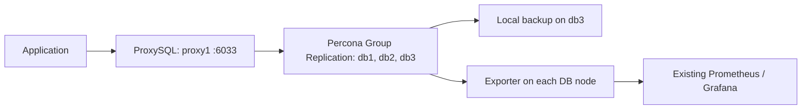

# Lab runbook: three-node Group Replication with one ProxySQL

This runbook deploys one ProxySQL endpoint in front of the existing three-node Percona Server 8.4 Group Replication cluster. It also configures the example backup source and exporters.



## What this deploys

- Three database nodes: one elected primary and two secondaries. Keep all three in the Group Replication play for quorum.
- One ProxySQL node, `proxy1`; `proxy2` is excluded from this run.
- The database and app account setup, a scheduled local full backup on `db3`, and a MySQL exporter on each database node.
- No ProxySQL VIP/Keepalived. Applications use `proxy1`'s address directly.

**Routing note:** the current defaults send application traffic to the current writer. No SELECT/read-splitting rule is configured, so this runbook does not pin reads to one secondary. ProxySQL admin is bound to loopback on the proxy.

## 1. Prepare the controller and hosts

Run commands from the repository root. Use fresh Ubuntu 24.04 amd64 VMs with SSH and sudo access. The Ansible controller needs Ansible Core 2.16 or newer and network access to download packages.

Install the pinned Ansible collections:

```bash
ansible-galaxy collection install -r requirements.yml
```

Allow these network paths in the lab firewall/security groups:

| Source → destination | Port/protocol | Purpose |
|---|---:|---|
| Application → proxy1 | TCP 6033 | MySQL application traffic |
| ProxySQL → each database | TCP 3306 | Application and monitoring connections |
| Database ↔ database | TCP 33061 | Group Replication |
| Prometheus → each database | TCP 9104 | Exporter scrape |
| Administrator → proxy1 (locally on proxy1 only) | TCP 6032 | ProxySQL admin interface |

Restrict database, exporter, and admin access to the required hosts/networks; do not expose them broadly.

## 2. Set inventory and credentials

Edit `inventories/group-one-proxy.yml` and replace the example addresses for `db1`, `db2`, `db3`, and `proxy1`. Assign a unique `percona_server_id` to each database node. The inventory already assigns `db3` as the backup source and all three database nodes as monitoring targets.

Set a fresh Group Replication UUID in `inventories/group_vars/all/main.yml`:

```bash
python3 -c 'import uuid; print(uuid.uuid4())'
```

Copy the key names from `inventories/group_vars/all/vault.example.yml` into an encrypted vault file and provide non-empty, strong values:

```bash
ansible-vault create inventories/group_vars/all/vault.yml
```

Required keys: `vault_percona_root_password`, `vault_replication_password`, `vault_backup_password`, `vault_exporter_password`, `vault_proxysql_admin_password`, `vault_proxysql_monitor_password`, and `vault_app_password`. Use the same root and Group Replication credentials across this sample cluster. Do not commit the encrypted vault or put plaintext secrets in inventory.

The sample inventory enables daily local full backups. MinIO is not enabled by default. ProxySQL HA is also disabled by default.

## 3. Check the inventory and playbook

Review the hosts Ansible will target:

```bash
ansible-inventory -i inventories/group-one-proxy.yml --graph --ask-vault-pass
```

Syntax-check the playbook against the same inventory:

```bash
ansible-playbook -i inventories/group-one-proxy.yml playbooks/group-one-proxy.yml \
  --syntax-check --ask-vault-pass
```

## 4. Deploy the stack

Run the complete deployment with the one-proxy inventory:

```bash
ansible-playbook -i inventories/group-one-proxy.yml playbooks/group-one-proxy.yml --ask-vault-pass
```

The playbook installs/configures the three database nodes one at a time, forms Group Replication, creates the application database on the elected writer, configures ProxySQL on `proxy1`, configures backups on `db3`, and installs exporters on all three database nodes. First deployment requires fresh nodes and package repository/download access. Review Ansible output; do not ignore a failed group member or continue with only part of the database group.

## 5. Verify Group Replication

On any database node, connect locally and check membership:

```bash
mysql -u root -p -e "SELECT MEMBER_HOST, MEMBER_STATE, MEMBER_ROLE FROM performance_schema.replication_group_members;"
```

Expected: three `ONLINE` members, one `PRIMARY`, and two `SECONDARY` members. The seed `db1` is only the initial bootstrap node; it is not guaranteed to remain primary.

## 6. Verify ProxySQL and application connectivity

From an application host, connect to `proxy1` on port 6033:

```bash
mysql -h <proxy1-ip> -P 6033 -u appuser -p appdb -e "SELECT @@hostname, @@global.read_only;"
```

The default user configuration routes to the current writer, so `@@global.read_only` should be `0`. The application should use this proxy address, not a database node address.

To inspect ProxySQL's registered backend servers, log in on `proxy1` itself (admin listens on loopback only):

```bash
mysql -h 127.0.0.1 -P 6032 -u admin -p -e \
  "SELECT hostgroup_id, hostname, port, status FROM runtime_mysql_servers ORDER BY hostgroup_id, hostname;"
```

Use the `proxysql_admin_password` value sourced from Vault. ProxySQL's Group Replication monitor updates writer/reader hostgroups as membership and roles change.

## 7. Check backups and metrics

Run a first full backup on `db3`:

```bash
sudo /usr/local/bin/percona-backup backup full
```

Backups are stored locally under `/var/backup/mysql`. With the sample settings, a daily full backup is scheduled for 01:00 in `db3`'s timezone. Monitor available disk space. MinIO uploads, retention deletion, and binlog archiving/PITR are not configured by this runbook.

Check the exporter on each database node:

```bash
curl http://<database-ip>:9104/metrics
```

Add the three exporter endpoints to an existing Prometheus scrape configuration; Prometheus, Grafana, dashboards, and alert delivery are not installed by this project.

## 8. Re-run individual configuration

After changing database settings, apply them one node at a time:

```bash
ansible-playbook -i inventories/group-one-proxy.yml playbooks/operations/configure.yml --ask-vault-pass
```

To reconfigure only the proxy:

```bash
ansible-playbook -i inventories/group-one-proxy.yml playbooks/operations/proxysql.yml --ask-vault-pass
```

## Lab safety

This is a test deployment, not production validation. One ProxySQL is a single point of failure; if it is unavailable, applications lose this endpoint even while the database group remains healthy. Test primary failover only in a disposable lab: active client connections may drop and must reconnect. Do not force-bootstrap a previously established group after a full outage.
