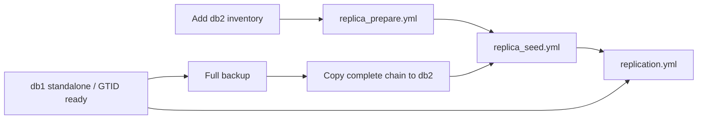

# Standalone → replica



1. Keep db1 in `primary`. Add db2 under `replicas` in the **same** inventory and set its SSH address. Its sample host_vars already specify ID 102 and read-only mode.
2. Run `ansible-playbook playbooks/replica_prepare.yml --ask-vault-pass`. This installs another 8.0 server; db1 is not reconfigured.
3. Configure backup on db1, run one full backup, and copy its completed directory (including manifest and success marker) to db2's `backup_path`. Include all parents if selecting an incremental. The seed play installs restore tooling itself; do not run the full backup role on an unseeded target.
4. Run the explicit seed on the isolated target:

```bash
ansible-playbook playbooks/replica_seed.yml --ask-vault-pass --limit db2 \
  -e backup_restore_target=db2 \
  -e backup_restore_id=REPLACE_WITH_BACKUP_ID \
  -e backup_restore_workdir=/var/tmp/percona-seed-001
```

5. Verify restored data and set `percona_replica_seeded: true` for db2. Provide `vault_replication_password` and private network/TLS settings.
6. Run `ansible-playbook playbooks/replication.yml --ask-vault-pass` on **both** database hosts; do not limit to only the replica.
7. On db2: `SHOW REPLICA STATUS\G`. Both threads must run with no last errors. Insert a test row on db1 and verify it arrives on db2.

The normal replication role never resets channels or GTIDs and never blindly reparents. During an **explicit isolated restore only**, copied channel metadata from a replica backup is cleared with `RESET REPLICA ALL` after verifying its threads are stopped; GTID history is preserved. A mismatched source, duplicate UUID/ID, errant transaction history, or unavailable purged history causes failure. Existing mismatched channels require a separate reviewed maintenance procedure.

The initial source and replica should share the configured root credential in this lab because physical restore copies account data. Restore targets must remain isolated from application traffic until verified. Source-side binlog retention must cover backup/copy/attach time.

Restores start read-only with automatic replica startup suppressed. Successful explicit attachment removes that temporary startup guard after checking the managed read-only baseline; subsequent ordinary restarts can resume the configured replica.
