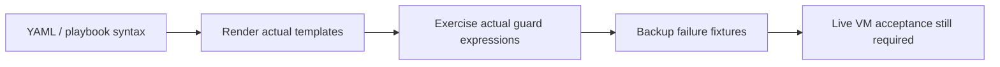

# What is validated



Run local checks from the repository root:

```bash
python3 tests/check.py
```

Requires Ansible with `requirements.yml` collections and Python PyYAML. This command uses localhost and temporary files only. It does not install packages, connect to database hosts, or execute real backups/restores.

| Local check | Evidence |
|---|---|
| YAML + all ten entry-point syntax checks | Every imported role task parses |
| Installed module parameter schemas | Validate supplied arguments against the pinned installed collection documentation |
| Actual template rendering | MySQL configuration, credential files, units, JSON, both recovery modes |
| Memory sizing | 2/4/8/16 GiB facts, missing facts, minimum pool, dedicated percentage, explicit override, smaller budget; invalid-input rejection |
| Actual Ansible guard expressions | Existing source, seed acknowledgement, topology/identity drift, explicit restore and recovery |
| Backup executable fixtures | Full/incremental continuity, missing base, corruption, upload/backup failure, source UUID changes, locking, prepare ordering and preservation of originals |
| Documentation | Component diagrams, role validation entry points, local links |

## Live acceptance before rollout

| Exercise | Required result |
|---|---|
| Fresh 8.0 VM | Repository/package availability, bootstrap, service and application login succeed |
| Second unchanged run | No credential churn or unnecessary database restart |
| Config-only update | Desired setting changes with one validated restart |
| Add exporter/backup | Original data remains; service accounts work locally and on replicas |
| Full + two incrementals | Restore real application rows/schema on another isolated 8.0 host |
| Failed object upload | Chain state unchanged; no completed remote artifact advertised |
| Add seeded replica | IDs/UUIDs unique, both threads healthy, test write arrives |
| Add proxy | Writer routing works, configuration survives restart, app reconnect tested |
| Observe topology | Authenticated UI and discovery work; recovery remains off |
| Enable recovery | Supplied fencing/routing hooks tested against failures and network partitions |

This workspace has no usable database VM or Docker daemon connection. Local checks are not substitutes for these exercises. No production readiness, throughput result, lossless failover or measured RTO is claimed.
