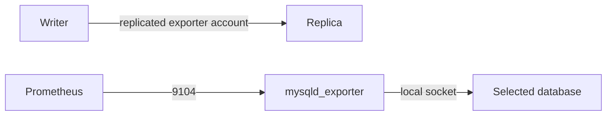

# mysql_exporter

Expose actual database health for an existing Prometheus scraper.

| Item | Value |
|---|---|
| Hosts | `monitoring_targets` |
| Inputs | `exporter_db_password`, account writer; `exporter_listen_address` for remote scraping. |
| Defaults | [defaults/main.yml](defaults/main.yml) |
| Entry point | [tasks/main.yml](tasks/main.yml) |
| Checks before changes | [tasks/preflight.yml](tasks/preflight.yml) |
| Checks after changes | [tasks/validation.yml](tasks/validation.yml) |

Defaults to loopback. Creates its own restricted account on the writer, installs a pinned checksummed binary, and restarts only when binary/config/service changes. Validation requires mysql_up=1, not just an open port. Prometheus/Grafana servers are external. If changing exporter_version, change its checksum URL too.

[Project quickstart](../../README.md) · [Live acceptance](../../docs/validation.md)
