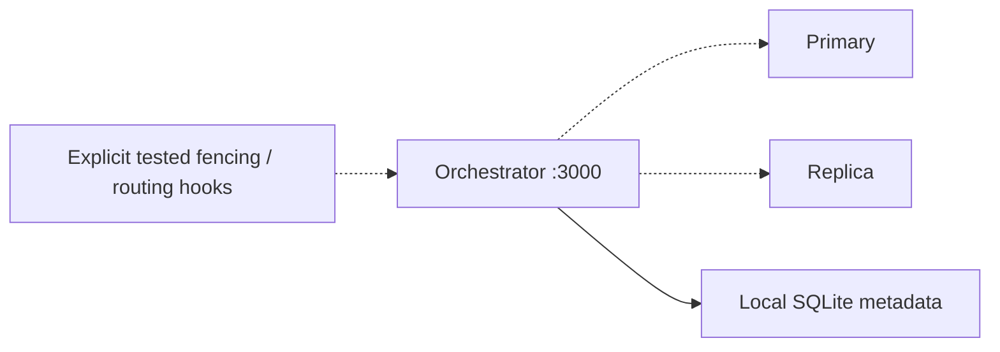

# orchestrator

Observe topology first; automatic recovery is an explicit later operation.

| Item | Value |
|---|---|
| Hosts | `orchestrators` |
| Inputs | Verified archive checksum, topology account password, HTTP Basic credentials; private addresses. |
| Defaults | [defaults/main.yml](defaults/main.yml) |
| Entry point | [tasks/main.yml](tasks/main.yml) |
| Checks before changes | [tasks/preflight.yml](tasks/preflight.yml) |
| Checks after changes | [tasks/validation.yml](tasks/validation.yml) |

Runs unprivileged, uses a local SQLite metadata file, and defaults to authenticated loopback HTTP with recovery filters empty. No additional MySQL server is installed on the control node. This is a single observer, not a redundant control plane. Recovery requires supplied executable hooks, tested acknowledgement and explicit filters. The old automatic rejoin code is retired; returned primaries remain an operator recovery task.

[Project quickstart](../../README.md) · [Live acceptance](../../docs/validation.md)
