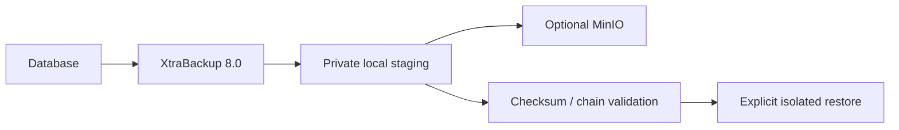

# percona_backup

Take recoverable full/incremental chains; prepare copies for restore.

| Item | Value |
|---|---|
| Hosts | `backup_sources`; restore is a separate entry point |
| Inputs | `backup_db_password`, `percona_account_host`; storage and schedule options. |
| Defaults | [defaults/main.yml](defaults/main.yml) |
| Entry point | [tasks/main.yml](tasks/main.yml) |
| Checks before changes | [tasks/preflight.yml](tasks/preflight.yml) |
| Checks after changes | [tasks/validation.yml](tasks/validation.yml) |

Uses its own account, root-readable credentials, a process lock, checkpoint metadata, checksums, success markers and atomic state. MinIO publishes a success marker last with verified TLS. Both modes retain local staging. No implicit retention deletion; size and monitor storage. Cron defaults off; full-only daily scheduling is the default when enabled. See the restore guide before enabling incrementals.

[Project quickstart](../../README.md) · [Live acceptance](../../docs/validation.md)
