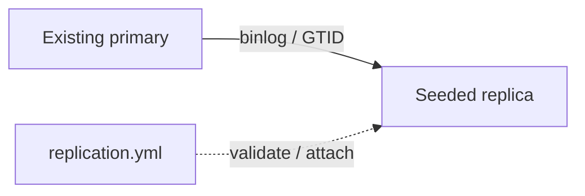

# percona_replication

Attach a verified replica without resetting existing replication history.

| Item | Value |
|---|---|
| Hosts | `database`, with `percona_primary` and `replicas` |
| Inputs | Matching `percona_replication_password`; explicit `percona_address`; `percona_replica_seeded: true` only after a verified seed. |
| Defaults | [defaults/main.yml](defaults/main.yml) |
| Entry point | [tasks/main.yml](tasks/main.yml) |
| Checks before changes | [tasks/preflight.yml](tasks/preflight.yml) |
| Checks after changes | [tasks/validation.yml](tasks/validation.yml) |

Supports one unnamed GTID channel. Unique identities, source selection, GTID compatibility, both replication threads and errors are checked. Reapplying does not reset channels; a managed password change updates channel credentials with a brief stop/start. The dedicated replication account uses mysql_native_password for this 8.0 baseline; enable verified TLS with the documented variables.

[Project quickstart](../../README.md) · [Live acceptance](../../docs/validation.md)
