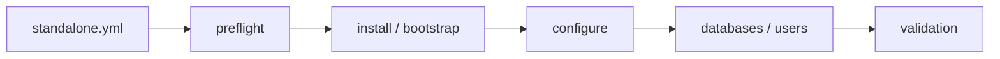

# percona_server

Install one database; keep its data and identity stable.

| Item | Value |
|---|---|
| Hosts | `primary` (or `replicas` through replica_prepare.yml) |
| Inputs | `percona_root_password`, unique `percona_server_id`, private `percona_bind_address`. |
| Defaults | [defaults/main.yml](defaults/main.yml) |
| Entry point | [tasks/main.yml](tasks/main.yml) |
| Checks before changes | [tasks/preflight.yml](tasks/preflight.yml) |
| Checks after changes | [tasks/validation.yml](tasks/validation.yml) |

The only owner of `mysqld.cnf`. GTID/binlogs are on from the first installation; the buffer pool defaults to 50% of detected RAM, with explicit overrides. Connections stay at 150 rather than scaling with RAM. See [memory sizing](../../docs/memory-sizing.md). Database creation never adds binlog filters. It refuses stale topology, changed server IDs and unreviewed adoption. Config-only: set `percona_install_packages: false`; configuration and validation still run.

[Project quickstart](../../README.md) · [Standalone verification commands](../../docs/standalone-verification.md) · [Live acceptance](../../docs/validation.md)
