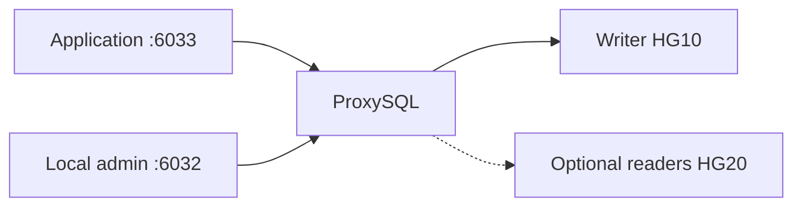

# proxysql

Add an application endpoint; begin with all traffic on the writer.

| Item | Value |
|---|---|
| Hosts | `proxies` |
| Inputs | Verified package checksum/URL, admin + monitor passwords, explicit backends and schema-scoped users. |
| Defaults | [defaults/main.yml](defaults/main.yml) |
| Entry point | [tasks/main.yml](tasks/main.yml) |
| Checks before changes | [tasks/preflight.yml](tasks/preflight.yml) |
| Checks after changes | [tasks/validation.yml](tasks/validation.yml) |

Uses idempotent collection modules and persists runtime/disk settings. Never clears unrelated query rules. Explicit state: absent removes an owned entry; omission preserves it. Initial admin credentials can be rotated using proxysql_bootstrap_admin_password. Admin remains local. This pinned 2.5.5 integration explicitly uses mysql_native_password for proxy-owned backend accounts on 8.0; it does not rewrite unrelated app accounts. Application endpoint cutover is separate.

[Project quickstart](../../README.md) · [Live acceptance](../../docs/validation.md)
